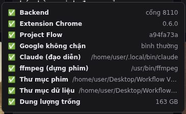

# 1. Cài đặt

Làm một lần, mất khoảng 20–30 phút. Xong bước cuối, đèn hệ thống trên canvas phải xanh hết như ảnh này:



## Cần có

| Thứ | Để làm gì | Kiểm tra |
|-----|-----------|----------|
| **Linux hoặc macOS** (Windows: dùng WSL2) | chạy backend + canvas | — |
| **Python 3.10+** | backend (FastAPI) | `python3 --version` |
| **Node.js 20+** | canvas (React) | `node --version` |
| **ffmpeg** | cắt, ghép, xuất phim | `ffmpeg -version` |
| **Google Chrome** | chạy extension nói chuyện với Google Flow | — |
| **Tài khoản Google có Flow** (có credit) | tạo ảnh, video bằng Omni Flash | mở https://flow.google.com |
| **Claude Code** đã đăng nhập | Claude làm biên kịch, đạo diễn, QC | `claude --version` |

Cài nhanh trên Ubuntu:

```bash
sudo apt install python3 python3-venv ffmpeg
curl -fsSL https://deb.nodesource.com/setup_20.x | sudo -E bash - && sudo apt install nodejs
npm install -g @anthropic-ai/claude-code && claude      # đăng nhập lần đầu
```

macOS: `brew install python@3.12 node ffmpeg`, rồi cài Claude Code như trên.

> Claude Code dùng gói Claude của bạn (Pro/Max) hoặc API key. Mỗi phim tốn vài chục lượt gọi Claude
> (viết kịch bản, chấm clip). Không cần `ANTHROPIC_API_KEY` nếu đã đăng nhập `claude`.

## Bước 1 — Lấy code

```bash
git clone <link-repo> flow-canvas
cd flow-canvas
```

Code nằm trong `flow-canvas/`. Dữ liệu chạy (`du-lieu/`) và phim xuất ra (`phim/`) sẽ tự tạo **bên cạnh**
thư mục này, không nằm trong repo.

## Bước 2 — Tạo file cấu hình `.env`

```bash
cp .env.example .env
```

Mở `.env`, thường chỉ cần điền **một dòng**:

```bash
FLOW_PROJECT_ID=xxxxxxxx-xxxx-xxxx-xxxx-xxxxxxxxxxxx
```

Lấy id này bằng cách: mở https://flow.google.com → tạo một project trống → copy đoạn uuid cuối URL.
Đây chỉ là project mặc định; mỗi phim mới làm trên canvas sẽ tự có project Flow riêng.

Các dòng còn lại để nguyên (cổng 8110 / 9233 / 5180, thư mục `../du-lieu` và `../phim`).

## Bước 3 — Nạp extension vào Chrome

1. Mở `chrome://extensions`
2. Bật **Developer mode** (góc phải trên)
3. Bấm **Load unpacked** → chọn thư mục `flow-canvas/backend/extension`
4. Extension tên **Flow Kit** hiện ra, id luôn là `neclhaioibipmpacbhbiaponiekddhnh` (khớp `FK_EXTENSION_ID` trong `.env`)

Sau đó **mở một tab https://flow.google.com, đăng nhập tài khoản có credit, và để nguyên tab đó**. Chỉ trang
Flow mới ký được lệnh gửi Google, nên hệ thống không chạy nếu tab này đóng.

> Muốn dùng nhiều tài khoản Google: mỗi tài khoản một Chrome profile, nạp extension vào từng profile, mỗi profile
> mở một tab Flow. Xem [Credit và tài khoản](04-credit-va-tai-khoan.md).

## Bước 4 — Chạy

```bash
./start.sh
```

Lần đầu script tự tạo `backend/.venv`, cài thư viện Python và `npm ci` cho canvas (2–5 phút). Khi thấy:

```
backend  http://127.0.0.1:8110  (pid …, log …)
canvas   http://127.0.0.1:5180
```

mở **http://127.0.0.1:5180**.

## Bước 5 — Kiểm tra

```bash
curl -s localhost:8110/health
# phải có: "extension_connected":true
```

Trên canvas, bấm **đèn hệ thống** ở giữa đáy màn hình. Mọi dòng phải ✅. Dòng nào ❌ thì trong bảng có ghi cách sửa;
xem thêm [Xử lý sự cố](05-xu-ly-su-co.md).

## Chạy hằng ngày

```bash
./start.sh            # backend chạy nền + canvas; Ctrl+C dừng cả hai
./start.sh backend    # chỉ backend
./start.sh canvas     # chỉ canvas
```

Nhớ: Chrome mở tab Flow trước, rồi mới bắt đầu làm phim.

## Cập nhật bản mới

```bash
git pull
./start.sh            # tự cài thêm thư viện mới nếu có
```

Nếu `requirements.txt` đổi mà backend báo thiếu thư viện: `backend/.venv/bin/pip install -r backend/requirements.txt`.

---
Tiếp theo: [2. Làm phim đầu tiên →](02-lam-phim-dau-tien.md)
