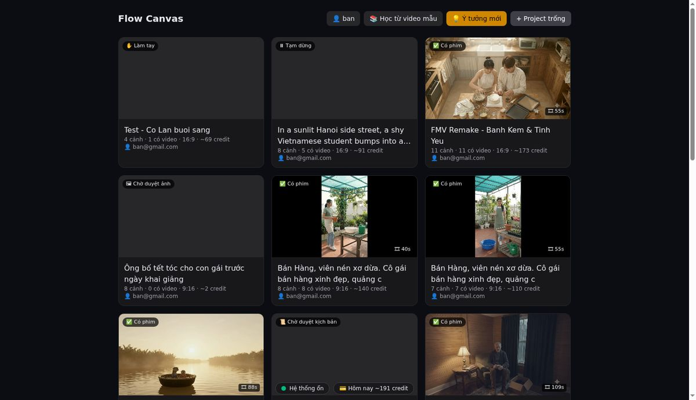
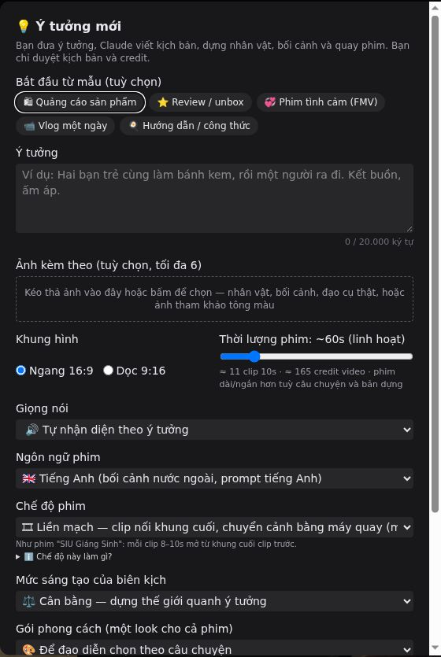
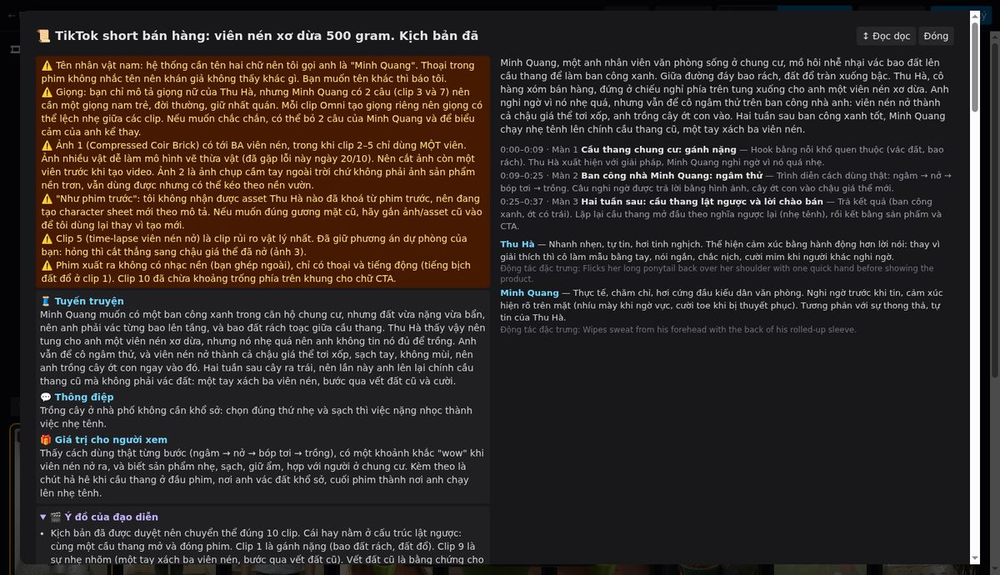
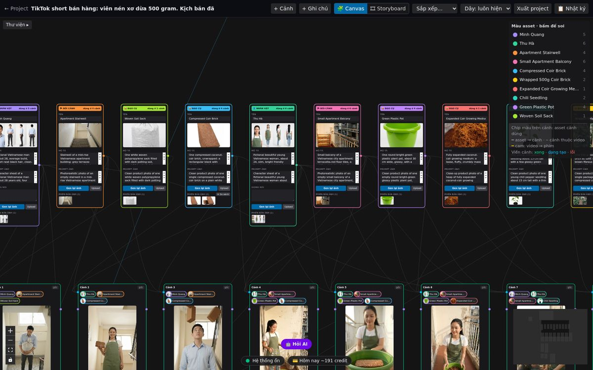
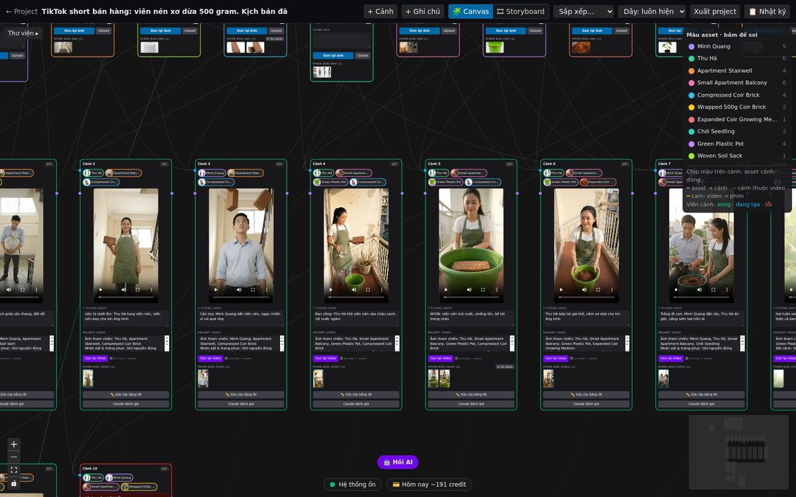
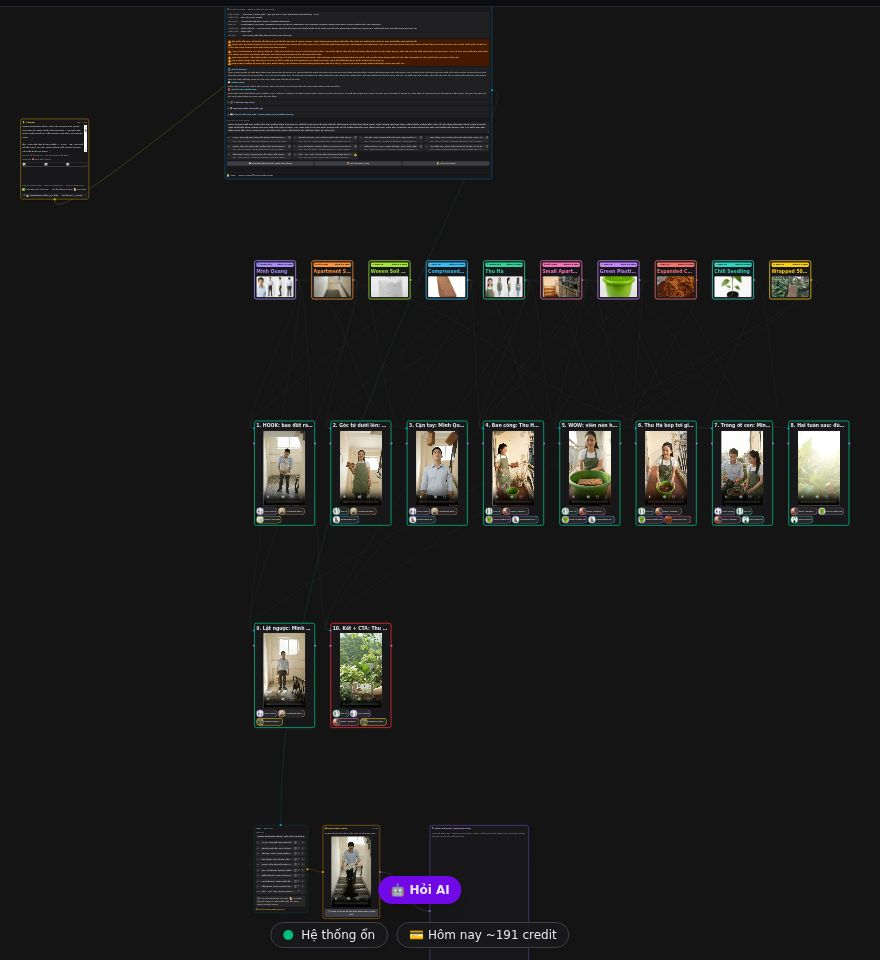
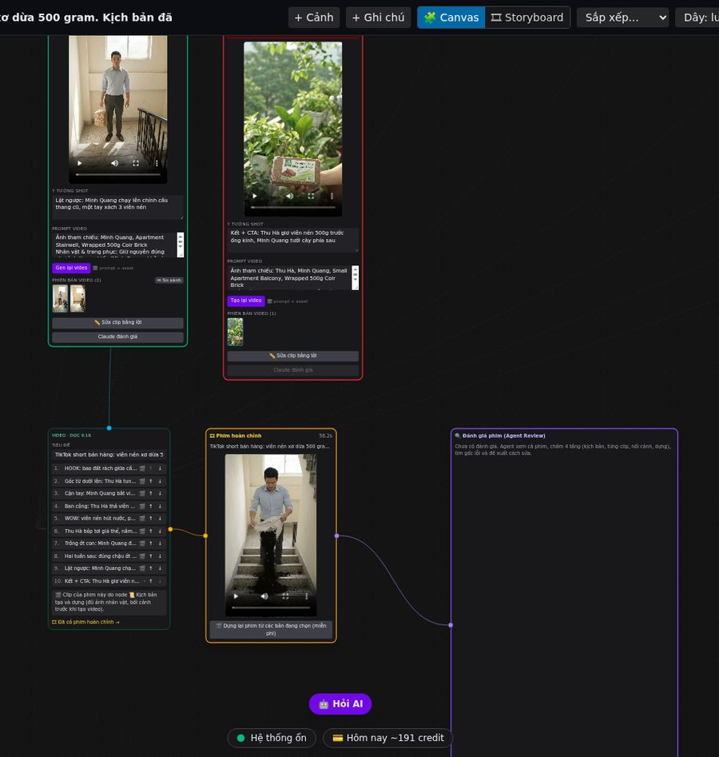
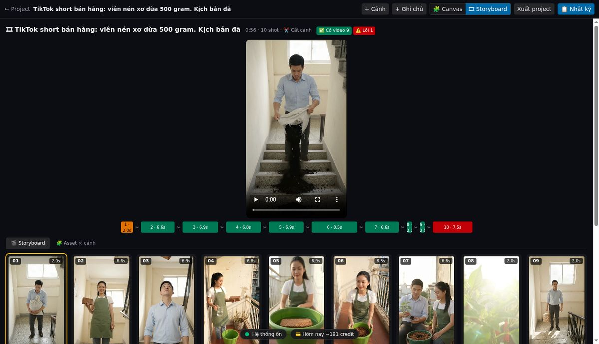

# 2. Làm phim đầu tiên

Trang này đi từng bước bằng một phim có thật: **TikTok bán hàng viên nén xơ dừa** (9:16, 10 clip, thoại tiếng Việt).


*Phim hoàn chỉnh: bao đất rách ở cầu thang → Hà tung viên nén → Minh bắt, nghi ngờ → ngâm trong chậu → bóp tơi → trồng ớt → Minh xách 3 viên nén lên cầu thang → Hà chào bán.*

Quy trình tổng quát:

```
💡 Ý tưởng ─▶ 📜 Kịch bản ─▶ 🖼 Asset ─▶ 🎬 Video từng clip ─▶ 🎞 Phim hoàn chỉnh
  (bạn)      (Claude viết,   (Flow tạo    (Flow tạo, Claude     (tự cắt, ghép,
              bạn duyệt)      ảnh)         chấm từng clip)       xuất 1080p)
```

**Hai chỗ bạn phải duyệt:** kịch bản (miễn phí), và credit trước khi tạo ảnh hoặc video. Hệ thống không bao giờ
tự tiêu credit khi bạn chưa bấm duyệt.

---

## Bước 1 — Trang chủ



Mỗi thẻ là một project. Nhãn góc trái cho biết trạng thái: *Chờ duyệt kịch bản*, *Chờ duyệt ảnh*, *Có phim*, *Lỗi*…
Dòng dưới cùng là tài khoản Google Flow mà project đang dùng.

Bấm **💡 Ý tưởng mới**.

## Bước 2 — Viết ý tưởng



| Ô | Chọn gì |
|---|---------|
| **Bắt đầu từ mẫu** | Quảng cáo sản phẩm, Review/unbox, Phim tình cảm, Vlog, Hướng dẫn. Bấm một mẫu để có khung ý tưởng sẵn |
| **Ý tưởng** | Viết tự nhiên, vài câu cũng được. Càng rõ **ai, muốn gì, gặp trở ngại gì, kết ra sao** thì kịch bản càng hay |
| **Ảnh kèm theo** (tối đa 6) | Ảnh sản phẩm thật, người thật, bối cảnh. Mỗi ảnh **một vật** thì Flow vẽ đúng hơn |
| **Khung hình** | Ngang 16:9 (YouTube) hoặc Dọc 9:16 (TikTok, Reels) |
| **Thời lượng** | Ước lượng thôi; câu chuyện quyết định độ dài thật. Bên dưới có ước tính số clip và credit |
| **Giọng nói** | Tự nhận diện · Lồng tiếng · Nhân vật nói · Không lời |
| **Ngôn ngữ phim** | Tiếng Anh (bối cảnh nước ngoài, mặc định) hoặc Tiếng Việt (bối cảnh Việt Nam, thoại tiếng Việt) |
| **Chế độ phim** | xem bảng dưới |
| **Mức sáng tạo** | *Bám sát* ý của bạn · *Cân bằng* · *Bay bổng* (Claude tự thêm nơi chốn, tuyến phụ) |

**Chế độ phim:**

| Chế độ | Hợp với | Cách dựng |
|--------|---------|-----------|
| 🎞 **Liền mạch** (mặc định) | phim kể chuyện cảm xúc | clip sau mở từ khung cuối clip trước, chuyển cảnh bằng máy quay |
| ✂️ **Cắt cảnh** | quảng cáo, TikTok nhanh, kịch tính | mỗi clip một ý, cắt cứng giữa các clip |
| 🖼 **Keyframe** | phim hành động một mạch | vẽ khung chính trước, Flow nối giữa các khung |
| 🎤 **Không khí buổi diễn** | MV, sân khấu, không kể chuyện | một địa điểm, nhiều góc, một bản nhạc |

**Ví dụ ý tưởng đã dùng cho phim mẫu** (rút gọn):

> TikTok short bán hàng: viên nén xơ dừa 500 gram. 9:16, ~40s, cắt cảnh, thoại tiếng Việt.
> Minh (nhân viên văn phòng ở chung cư) muốn có ban công xanh nhưng đất nặng, bẩn; bao đất rách giữa cầu thang.
> Thu Hà (cô bán hàng, hàng xóm) tung cho anh một viên nén. Anh nghi ngờ, nhưng thử: viên nén nở thành cả chậu
> giá thể. Cuối phim anh chạy lên chính cầu thang đó, một tay xách 3 viên nén.
> Thông điệp: trồng cây ở nhà phố không cần khổ sở.

Bấm **✍️ Viết kịch bản**. Bước này **miễn phí**, mất 5–15 phút. Node 💡 hiện từng bước Claude đang làm.

## Bước 3 — Đọc và duyệt kịch bản



Bấm **📖 Đọc toàn bộ kịch bản** để xem rộng:

- **Khung cam** ở đầu: những điều Claude muốn bạn biết trước (ở đây: ảnh sản phẩm có 3 viên trong khi clip cần 1,
  giọng nam có thể lệch giữa các clip…). **Đọc kỹ phần này.**
- **Tuyến truyện, Thông điệp, Giá trị cho người xem**: câu chuyện có nguyên nhân → kết quả, không phải các cảnh ghép rời.
- **Màn và nhân vật** ở cột phải; từng clip, thoại, chuyển cảnh ở phía dưới.

Chưa ưng → bấm **Yêu cầu sửa** và viết bằng lời ("clip 3 cho Minh cười", "rút còn 8 clip"). Vẫn miễn phí.

Ưng rồi thì chọn:
- **▶ Tạo từng bước**: tạo ảnh asset trước → bạn xem → duyệt tiếp mới tạo video. **Nên dùng cho phim đầu tiên.**
- **⏩ Chạy toàn bộ**: duyệt một lần, hệ thống tự đi đến phim cuối.

Cả hai đều hiện **số credit dự kiến** trước khi bạn bấm.

## Bước 4 — Asset: nhân vật, bối cảnh, đạo cụ



Flow tạo từng ảnh một (~1 credit/ảnh). Mỗi asset là một thẻ có nhãn loại (NHÂN VẬT / BỐI CẢNH / ĐẠO CỤ)
và một màu riêng; màu đó cũng là chip trên các cảnh dùng asset này. Ảnh nhân vật là **character sheet** (mặt + toàn thân nhiều góc), ảnh bối cảnh là **nơi trống không người**.

Asset nào sai (ví dụ viên nén có 3 viên thay vì 1):
- **Gen lại ảnh** trên thẻ đó, hoặc
- **Upload** ảnh của bạn thay vào (miễn phí).

Xem ví dụ asset tốt ở [Mẹo làm phim](03-meo-lam-phim.md#ảnh-tham-chiếu-quyết-định-tất-cả). Duyệt asset xong mới sang tạo video.

## Bước 5 — Video từng clip



Mỗi cảnh là một clip 10 giây (~15 credit), tạo từ **prompt + các asset gắn chip màu** ở đầu thẻ (r2v: reference-to-video).
Hệ thống gửi Flow **từng lệnh một**; viền thẻ xanh lá = xong, xanh dương = đang tạo, đỏ = lỗi.

Claude **chấm từng clip** (QC): clip hỏng vật lý, sai mặt nhân vật… thì tự tạo lại trong ngân sách bạn đã duyệt.

Trên mỗi cảnh có:
- **✏️ Sửa clip bằng lời**: "cho Hà cười khi nói", Claude viết lại riêng prompt clip đó, bạn xem chỗ đổi rồi mới dùng.
- **Gen lại video**: tốn credit.
- **⇔ So sánh phiên bản**: nếu clip đã tạo nhiều lần, chọn bản đẹp nhất.

Toàn cảnh canvas của phim mẫu, từ trên xuống: ý tưởng + kịch bản → hàng asset → 10 cảnh → phim:



## Bước 6 — Phim hoàn chỉnh



Hệ thống tự cắt mỗi clip còn đoạn đẹp nhất (thường 3–7 giây), ghép, xuất 1080p. Node **🎞 Phim hoàn chỉnh** phát phim;
file nằm ở:

```
phim/<ten-project>_<ma>/final.mp4
```

- **🎬 Dựng lại phim từ các bản đang chọn** (miễn phí): sau khi đổi bản clip hoặc chỉnh điểm cắt.
- **🔍 Đánh giá phim**: Claude xem cả phim và chỉ ra chỗ hụt (chỉ tốn lượt Claude, không tốn credit Flow).
- **📦 Gói kịch bản (.md)**: tải kịch bản + prompt để lưu hoặc chia sẻ.

## Xem dạng Storyboard



Nút **🎞 Storyboard** ở thanh trên: video lớn theo thứ tự phim, thanh thời gian từng clip (màu đỏ = clip có lỗi),
và bảng *Asset × cảnh* cho biết cảnh nào dùng asset nào.

## Phim mẫu này tốn bao nhiêu?

| Hạng mục | Số lượng | Credit |
|----------|----------|--------|
| Ảnh asset | ~7 ảnh | ~7 |
| Video | 10 clip + 3 lần tạo lại | ~195 |
| Kịch bản, QC, dựng | — | 0 (chỉ tốn lượt Claude) |

Thời gian: ~1 giờ viết kịch bản và duyệt, ~1,5 giờ chờ Flow tạo video.

---
← [1. Cài đặt](01-cai-dat.md) · Tiếp theo: [3. Mẹo làm phim →](03-meo-lam-phim.md)
