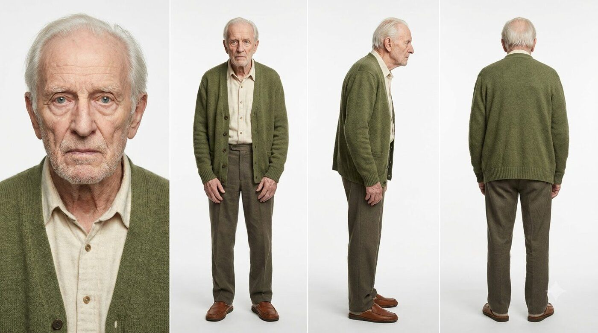
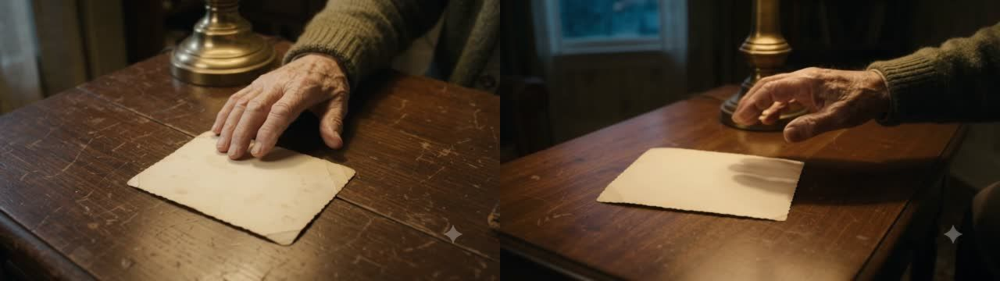
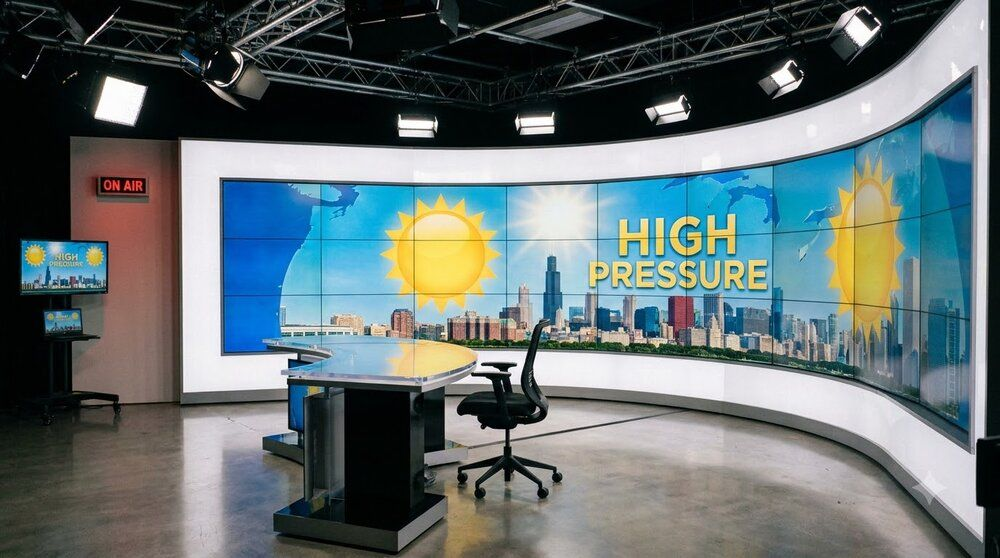
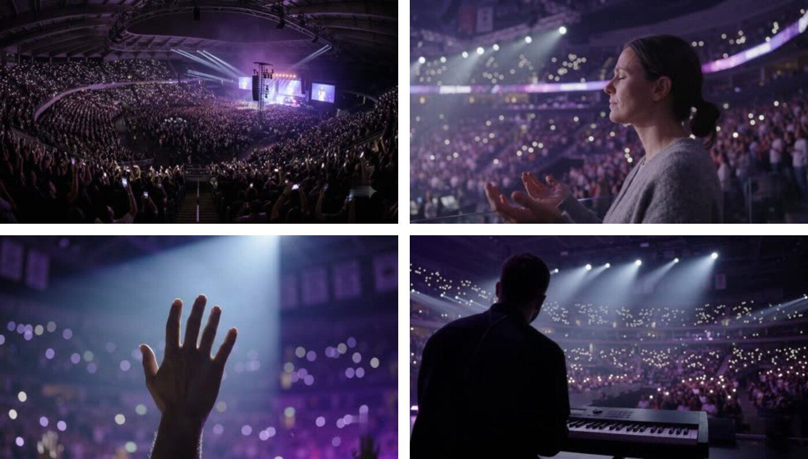

# 3. Mẹo làm phim

Bản rút gọn những gì đã học sau hơn 10 phim làm bằng Google Flow Omni Flash. Claude đã được dạy tất cả những điều
này (trong [sổ tay `playbook/`](../backend/agent/director/knowledge/playbook/)); trang này để **bạn** biết vì sao
kịch bản được viết như vậy và viết ý tưởng tốt hơn.

## Viết ý tưởng tốt

Ý tưởng hay = **câu chuyện có nhân quả**, không phải danh sách cảnh đẹp. Trả lời được 4 câu:

| Câu hỏi | Phim xơ dừa |
|---------|-------------|
| Ai muốn gì? | Minh muốn có ban công xanh |
| Vướng gì? | Đất nặng, bẩn, vác lên tầng cực khổ, bao rách giữa cầu thang |
| Thay đổi thế nào? | Thử viên nén, nó nở thành cả chậu giá thể |
| Kết lại ra sao? | Minh chạy lên chính cầu thang cũ, một tay xách 3 viên nén |

Thêm **thông điệp** (một câu) và **giá trị cho người xem** (họ học được gì, thấy được khoảnh khắc "wow" nào).

✅ *"Anh nhân viên văn phòng vác đất lên chung cư thì bao rách; cô hàng xóm đưa viên nén xơ dừa…"*
❌ *"Video quảng cáo viên nén xơ dừa, đẹp, chuyên nghiệp, 40 giây."*

Bạn chỉ cần đưa ý; Claude tự dựng thế giới (nơi chốn, quá khứ, nhân vật phụ). Muốn Claude bám sát đúng từng chữ → chọn
mức sáng tạo *Bám sát*.

## Ảnh tham chiếu quyết định tất cả

Mọi clip được tạo theo kiểu **r2v** (reference-to-video): prompt + các ảnh tham chiếu. Ảnh tốt thì cả phim cùng một
người, cùng một nơi. Ảnh sai thì không prompt nào cứu được.

**Nhân vật = một character sheet:** cận mặt + toàn thân trước, nghiêng, sau, nền trắng.

**Bối cảnh = nơi trống, không có người**, đúng khổ phim. Nhân vật được đặt vào sau:

**Đạo cụ = mỗi ảnh một vật**, nền sạch. Ảnh có 3 viên nén thì Flow sẽ vẽ 3 viên.

Có ảnh thật (sản phẩm, người, nơi chốn)? Đính kèm ở bước ý tưởng, hoặc **Upload** thay ảnh asset. Miễn phí và luôn tốt hơn ảnh AI.

## Giới hạn của Omni Flash

| Luật | Vì sao |
|------|--------|
| **Tối đa 2 hành động mỗi clip** | "Quay lại, cười và bước đi" là 3 hành động: Flow làm méo hoặc bỏ bớt |
| **Tối đa 1 chuyển cảnh mỗi clip**, có 2–3 giây đứng yên trước đó | Chuyển cảnh vội thì hình vỡ |
| **Một clip một ý** | Clip 10s, khi dựng chỉ giữ 3–7s đẹp nhất |
| **Viết theo vật lý**: lực, tiếp xúc, trọng lượng, nước chảy | Viết "phép màu" (vật tự hiện, lơ lửng) thì ra hình vô lý |
| **Trẻ em luôn có người lớn cùng khung** | Flow chặn bé một mình trong khung |
| **Không làm giống bản tin truyền hình**, không giống người nổi tiếng | Flow chặn (xem dưới) |
| **Mỗi clip tối đa một câu thoại ≤ 15 chữ**, mô tả giọng giống hệt nhau ở mọi clip | Mỗi clip Flow tạo giọng riêng; tả giống nhau thì nghe như một người |

## Nối clip: liền mạch hay bị giật

Clip sau phải **bắt đầu đúng chỗ clip trước dừng**: cùng bàn, cùng đèn, cùng cốc, tay cùng bên.

✅ Đúng: cùng căn bếp, cùng đèn bàn, cùng cái cốc, chỉ đổi góc máy.

❌ Sai: chuyển cảnh bị chia ra hai clip (cuối clip này là ánh sáng, đầu clip sau là đèn dầu), nên trên phim nó thành cú cắt cứng.

❌ Sai: tờ giấy và bàn tay nhảy vị trí giữa hai clip.

Hệ thống có lint tự bắt phần lớn lỗi này khi viết prompt, nhưng hãy xem lại chỗ nối khi duyệt phim.

## Flow chặn những gì

Phòng thu có chữ **ON AIR**, màn hình tin tức, bàn dẫn: Flow từ chối với lý do "rủi ro xuyên tạc sự kiện".
Phía mình chỉ thấy lỗi `NO_MEDIA_CREATED`.

Tương tự với nhân vật có mặt giống người nổi tiếng. Cách sửa ở [Xử lý sự cố](05-xu-ly-su-co.md).

## Phim không kể chuyện (MV, sân khấu)

Chế độ *Không khí buổi diễn*: một địa điểm, bốn loại cảnh xen nhau (toàn cảnh đám đông, cận mặt, chi tiết tay, người biểu diễn), một bản nhạc.

## Độ dài và nhịp dựng

- Thời lượng bạn chọn chỉ là ước lượng. Câu chuyện quyết định, hệ thống không độn hay cắt truyện cho đủ giây.
- TikTok: mở bằng **hook trong 2 giây đầu** (bao đất rách), clip dài nhất 5–6s, kết bằng lời kêu gọi.
- Clip có thoại **không bị cắt giữa câu**, nên phim có thể dài hơn mục tiêu vài giây. Muốn ngắn hơn: bớt thoại.
- Phim xuất 1080p, nén một lần (Flow tạo 720p, 24 hình/giây).

## Đọc thêm

- [Kiến thức làm phim](kien-thuc-lam-phim.md): khuôn prompt, giọng nói, dựng, hiệu ứng kiểu CapCut
- [Sổ tay `playbook/`](../backend/agent/director/knowledge/playbook/): bản đầy đủ Claude đọc khi làm, gồm nhật ký từng phim (07) và lời dặn (00)

---
← [2. Làm phim đầu tiên](02-lam-phim-dau-tien.md) · Tiếp theo: [4. Credit và tài khoản →](04-credit-va-tai-khoan.md)
