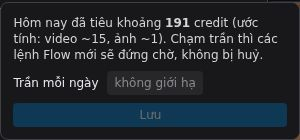

# 4. Credit và tài khoản

## Giá

| Việc | Credit Flow |
|------|-------------|
| Ảnh asset (nhân vật, bối cảnh, đạo cụ) | ~1 / ảnh |
| Video Omni Flash 10 giây | ~15 / clip |
| Viết kịch bản, QC clip, dựng phim, sửa prompt, dựng lại | 0 (chỉ tốn lượt Claude) |
| Upload ảnh của bạn, chuyển phim sang tài khoản khác | 0 |
| Lệnh bị Flow từ chối ngay khi gửi | 0 |

**Dự toán một phim** ≈ số clip × 15 × 1,2 (dự phòng tạo lại) + số asset.

| Phim | Clip | Dự toán |
|------|------|---------|
| TikTok 30–40s | 7–10 | 130–190 credit |
| Phim ngắn 1 phút | 11–12 | 200–230 credit |
| Phim 2 phút | ~22 | ~400 credit |

Phim mẫu xơ dừa thực tế: ~7 ảnh + 13 lượt video ≈ 200 credit.

## Hệ thống giữ credit cho bạn thế nào

- **Mọi bước tốn credit đều chờ bạn bấm duyệt**, và nút duyệt ghi sẵn số credit dự kiến.
- **Ngân sách theo cổng**: khi duyệt tạo video, Claude chỉ được tạo lại clip hỏng trong số lượt đã duyệt.
- **Không có video nào chạy khi thiếu ảnh tham chiếu.** Lỗi này từng làm mất ~60 credit, giờ đã bị chặn.
- **Gửi từng lệnh một**, cách nhau vài giây, để Google không coi là bot.
- **💳 Credit hôm nay** ở đáy màn hình: ước tính số đã tiêu trong ngày (Flow không trả số dư). Bấm vào để đặt
  **trần mỗi ngày**: chạm trần thì lệnh mới đứng chờ, không bị huỷ.

> Số dư thật: xem trong Flow (ảnh đại diện → credits). Hệ thống chỉ ước tính phía mình.

## Dùng nhiều tài khoản Google

Một phim **gắn với một tài khoản**: ảnh và video tạo ở tài khoản A không dùng được ở tài khoản B.

**Cài đặt:** mỗi tài khoản một Chrome profile → nạp extension vào profile đó → mở tab https://flow.google.com
đăng nhập đúng tài khoản. Backend tự nhận ra email của từng tab. Nút **👤** trên trang project cho biết tài khoản
nào đang kết nối, còn dùng được hay đã hết credit.

**Khi một tài khoản hết credit giữa phim:**

1. Node kịch bản báo **⛔ Tài khoản … hết credit**, kèm danh sách tài khoản khác còn credit đang kết nối. Các lệnh
   chưa gửi được giữ lại, không mất lượt.
2. Chọn một trong hai:
   - Nạp thêm credit cho tài khoản đó rồi bấm **Tài khoản này đã có credit lại — chạy tiếp**: chạy tiếp đúng những
     lệnh cũ, không tạo trùng.
   - Bấm **đổi tài khoản** (cạnh 👤 trên node kịch bản) → chọn tài khoản khác, rồi bấm nút chạy tiếp ở trên. Hệ thống tạo project Flow mới ở tài
     khoản đó và tải lại các ảnh asset từ máy (**không tốn credit**). Clip đã xong giữ nguyên, clip còn thiếu tạo tiếp
     ở tài khoản mới.
3. Trước khi đổi, đợi không còn clip nào đang tạo dở.

Phim mẫu xơ dừa đã làm đúng như vậy: 4 clip đầu ở tài khoản 1, hết credit, chuyển sang tài khoản 2 làm nốt 6 clip.

---
← [3. Mẹo làm phim](03-meo-lam-phim.md) · Tiếp theo: [5. Xử lý sự cố →](05-xu-ly-su-co.md)
